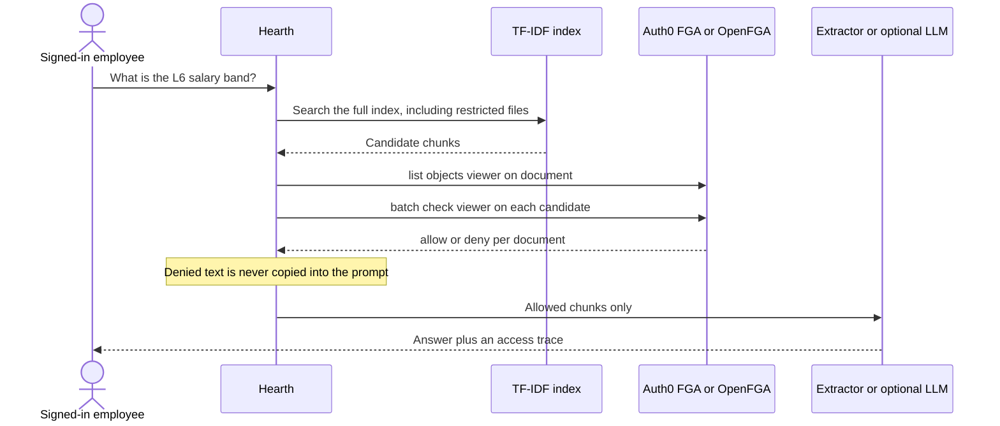
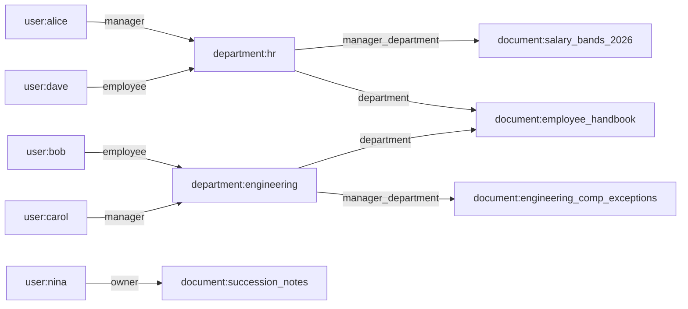

# Hearth — The Privacy-Aware RAG Bot (Auth0 FGA)

Internal HR assistant for the MLH Global Hack Week challenge. Hearth answers from a small document index, and it decides **which passages the model is allowed to see** with [Auth0 FGA](https://docs.fga.dev/) / [OpenFGA](https://openfga.dev/) before anything is written into a prompt.

The prompt is not the lock. A general employee can ask for the 2026 salary bands, the retriever will find that file in the index, and FGA will drop it. The assistant never receives the text.

By default the app is fully offline: an in-memory evaluation of `model.fga`, TF-IDF retrieval, and an extractive answer. Point it at OpenFGA or Auth0 FGA with environment variables when you want a real authorization server. An OpenAI-compatible model is optional.

## How a question is answered



Fail closed: if the batch check errors, every candidate is withheld and the optional model is not called.

## Authorization model

`model.fga` is the source of truth. A document is viewable by its owner, by a member of a linked department, or by someone who holds the **manager role** on a linked department. `member` is `employee or manager`, so managers can read what their department can read, but a manager-only file does not open for an employee of that same department.

```fga
model
  schema 1.1

type user

type department
  relations
    define employee: [user]
    define manager: [user]
    define member: employee or manager

type document
  relations
    define owner: [user]
    define department: [department]
    define manager_department: [department]
    define viewer: [user, user:*, department#member, department#manager] or owner or member from department or manager from manager_department
```



`salary_bands_2026` is linked only through `manager_department` to HR. Alice, the HR manager, can view it. Dave, an HR employee, cannot. Bob, an engineering employee, cannot. Nina, the CEO, cannot: seniority is not a permission. The handbook is linked to every department's `member` relation, so every employee can view it, and a stranger with no department tuple cannot.

Direct `viewer` tuples are also legal (`user`, `user:*`, or `department#member` / `department#manager`). The performance rubric is shared that way, with each department's manager userset. Succession notes use `owner` and name Nina only.

Sample tuples live in `data/tuples.json`. The directory the UI shows is display data. FGA does not read it.

| User | Directory role | Can view |
| --- | --- | --- |
| Alice Chen | HR manager | Handbook, leave, HR recruiting playbook, salary bands, performance rubric |
| Dave Alvarez | HR employee | Handbook, leave, HR recruiting playbook |
| Bob Okonkwo | Engineering employee | Handbook, leave, engineering onboarding |
| Carol Singh | Engineering manager | Handbook, leave, onboarding, engineering comp exceptions, performance rubric |
| Eve Novak | Finance employee | Handbook, leave |
| Frank Müller | Finance manager | Handbook, leave, performance rubric |
| Nina Petrov | Executive manager and owner of the succession note | Handbook, leave, performance rubric, succession notes |

## Sample corpus

Eight fictional HR documents in `data/docs/`. The figures are not real compensation.

| Document | Who can view it |
| --- | --- |
| `employee_handbook` | Every department member |
| `pto_and_leave` | Every department member |
| `engineering_onboarding` | Engineering members |
| `hr_recruiting_playbook` | HR members |
| `salary_bands_2026` | HR managers only |
| `engineering_comp_exceptions` | Engineering managers only |
| `performance_review_rubric` | Managers of any department |
| `succession_notes` | Owner Nina only |

## Run it offline

```bash
python3 -m pip install -r requirements.txt
pytest
python -m app.demo
uvicorn app.main:app --host 0.0.0.0 --port 8000
```

Open http://localhost:8000. Nobody is signed in until you pick a demo employee. Start as Bob, ask for the L6 band, then switch to Alice and ask again. The dev switcher is on whenever `AUTH0_CLIENT_ID` is empty. It is a local convenience, not a production login. Leave it off on any shared host (`DEV_USER_SWITCHER=false`).

Copy `.env.example` to `.env` if you want to set variables. Real environment variables win over the file.

## Local OpenFGA

```bash
docker compose up --build
```

That starts OpenFGA 1.8.16 with the in-memory datastore (HTTP on port 8080, playground on port 3000) and Hearth on port 8000. On startup Hearth creates a store named `hearth-hr`, writes `model.fga`, and writes the sample tuples. The playground can run the same checks, for example user `user:alice`, relation `viewer`, object `document:salary_bands_2026`.

To point a locally run process at OpenFGA instead of the in-memory evaluator:

```bash
export FGA_API_URL=http://localhost:8080
export FGA_AUTO_BOOTSTRAP=true
uvicorn app.main:app --port 8000
```

## Auth0 FGA cloud

Use a store you already created. Bootstrap is off by default once client credentials are present, so a cloud store is not overwritten unless you opt in.

```bash
export FGA_API_URL=https://api.us1.fga.dev
export FGA_STORE_ID=...
export FGA_CLIENT_ID=...
export FGA_CLIENT_SECRET=...
export FGA_API_AUDIENCE=https://api.us1.fga.dev/
export FGA_API_TOKEN_ISSUER=https://auth.fga.dev
export FGA_AUTHORIZATION_MODEL_ID=...   # optional; otherwise the latest model is used
# export FGA_AUTO_BOOTSTRAP=true        # writes this repo's model and sample tuples
```

The client speaks the same HTTP API as OpenFGA. It sends a client-credentials bearer token when `FGA_CLIENT_ID` is set. If `/batch-check` is missing on an older server, it falls back to `/check` per candidate. That fallback still runs before the prompt is built.

## Auth0 login

The default tenant is `dev-wvxvhbnjrgvgn26x.us.auth0.com`.

1. Create a Regular Web Application in that tenant.
2. Allowed Callback URL: `http://localhost:8000/callback`
3. Allowed Logout URL: `http://localhost:8000/`
4. Set `AUTH0_CLIENT_ID`, `AUTH0_CLIENT_SECRET`, and `AUTH0_CALLBACK_URL`.

Hearth maps the login to a directory id in this order:

1. Custom claim `fga_user` or `https://hearth.northline.example/fga_user` (this may name any employee id).
2. `nickname` or `preferred_username`, only if it is already a directory id such as `alice` or `bob`.
3. The email local-part, only if it is already a directory id.
4. Otherwise `auth0_` plus a sanitized `sub`. That user has no tuples, so every document is denied.

The display name is ignored. A profile that says "HR Manager" does not grant the manager role. Set `DEV_USER_SWITCHER=true` if you still want the demo switcher next to Auth0.

## Optional model

Leave the LLM variables unset and Hearth quotes the allowed passages itself. To use an OpenAI-compatible chat API:

```bash
export LLM_API_KEY=...          # or OPENAI_API_KEY
export LLM_BASE_URL=https://api.openai.com/v1
export LLM_MODEL=gpt-4o-mini
```

The model is only called when at least one allowed passage survived FGA. It is instructed to stay inside that context. That instruction is not the control.

## Example output

`python -m app.demo` against the offline evaluator:

Alice Chen, HR manager, asks "What is the L6 engineering base salary band?"

```text
Here is what the documents you can access say.

From Salary Bands 2026:
The L6 engineering base salary band is 242000 USD (reference SENTINEL_SALARY_L6_242000).
The L6 product manager base salary is 228000 USD.

trace: salary_bands_2026:allow, engineering_comp_exceptions:deny, engineering_onboarding:deny, succession_notes:deny, hr_recruiting_playbook:allow
withheld: 3
```

Bob Okonkwo, engineering employee, asks the same question. The salary file is still the top hit in the index. It is not quoted.

```text
I can't answer that from documents you are allowed to read. Matching files may exist in the index, but your role and department do not grant view access, so those passages were withheld before an answer was written.

trace: salary_bands_2026:deny, engineering_comp_exceptions:deny, engineering_onboarding:allow, succession_notes:deny, hr_recruiting_playbook:deny
withheld: 4
```

Dave, the HR employee who is not a manager, gets the same refusal. The band text never appears.

Bob asking "How many vacation days do full-time employees receive?" is allowed to read the leave policy:

```text
From Time Off and Leave:
Full-time employees receive 22 days of paid vacation each calendar year.
Part-time employees receive a prorated balance.
```

Carol, engineering manager, can read the retention exception. Bob cannot. The trace for Bob marks `engineering_comp_exceptions:deny`.

```text
From Engineering Compensation Exceptions:
A staff engineer with a written competing offer may receive a retention grant of up to 88000 USD (reference SENTINEL_ENG_RETENTION_88000).
The engineering manager and the finance manager must both approve the grant.
```

Nina can read the succession note she owns. Alice, despite being the HR manager, cannot. Her trace marks `succession_notes:deny`.

## Tests

```bash
pytest -q
```

The suite covers:

- The model text and the sample tuples, including Alice as HR manager and Bob as an engineering employee.
- `list_objects` / `batch_check` agreement for every demo user, in memory.
- A manager receiving the salary sentinel in the prompt, and an employee not receiving it, including when the only candidate is the salary file.
- FGA called (`list_objects`, then `batch_check`) before the completion function.
- Fail closed when FGA raises, and when either the list or the batch check denies the file.
- The HTTP client: Auth0 FGA bearer tokens, item errors treated as deny, and `/check` fallback.
- The API session: a body field cannot switch the user; Bob's JSON does not contain the salary sentinel; Auth0 `/login` redirects to `dev-wvxvhbnjrgvgn26x.us.auth0.com`.

## Layout

```text
model.fga                 Authorization model
data/docs                 Eight HR documents
data/tuples.json          Relationship tuples
data/users.json           Demo directory for the switcher
app/fga                   DSL parser, in-memory evaluator, HTTP client
app/rag                   TF-IDF index and the filter-then-answer pipeline
app/main.py               API, Auth0 login, dev switcher
static                    Desk UI
docker-compose.yml        OpenFGA + Hearth
```

## Security notes

- The signed-in user comes from the session, never from the question body.
- Denied excerpts are not returned to the browser. A withheld trace row has the document id and the score only.
- Unknown Auth0 subjects do not fall through to Alice or any other demo user.
- Do not enable the dev switcher on a public host. Do not treat this sample corpus or this demo tenant mapping as a production IdP integration.
